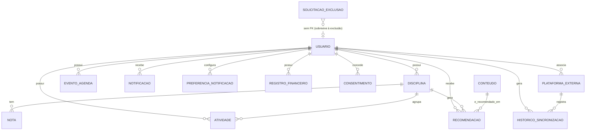

# Learning Score

Plataforma web que centraliza a vida acadêmica do estudante: atividades, prazos, notas, informações financeiras, calendário, notificações, recomendações de conteúdo e mini-player de vídeo.
Projeto acadêmico de Engenharia de Software (Igor e Lucas).

> **Estado de verificação (leia):** o código foi escrito e revisado, mas **ainda não foi compilado nem executado** — o ambiente em que foi gerado não tinha Maven, PostgreSQL nem acesso à internet. Verificados: sintaxe do JavaScript, pacotes/imports internos do Java. **Pendente:** `mvn test`, subir a aplicação e percorrer as telas. Veja "Primeira execução" abaixo.

## Objetivo
Reunir em um painel único os compromissos acadêmicos, reduzindo esquecimentos de prazos. **Não usa inteligência artificial**: as recomendações usam um critério objetivo de palavras-chave.

## Tecnologias
Java 21 · Spring Boot 3.3 (Web, Data JPA/Hibernate, Security, Validation) · Maven · PostgreSQL 16 · Flyway · HTML5/CSS3/JavaScript puro · Chart.js (CDN) · JUnit 5, Mockito, Spring Boot Test.

## Pré-requisitos
JDK 21, Maven 3.9+, PostgreSQL 14+ (ou Docker).

## Banco de dados (PostgreSQL)
```bash
export DB_PASSWORD='troque_esta_senha'
docker compose up -d            # sobe o PostgreSQL com banco/usuário "learningscore"
```
Sem Docker: crie o banco `learningscore` e o usuário `learningscore` com a senha escolhida. As tabelas são criadas pelo **Flyway** (`backend/src/main/resources/db/migration/V1__criar_esquema.sql`) ao iniciar.

## Executar o back-end (e o front-end)
```bash
cd backend
export DB_PASSWORD='troque_esta_senha'
mvn spring-boot:run
```
Abra **http://localhost:8080**. O front-end fica em `backend/src/main/resources/static/` e é servido pelo próprio Spring Boot (mesma origem → sem CORS e com cookie de sessão seguro). Escolhemos isso em vez de uma pasta `frontend/` separada para rodar com um único comando; para separar depois, basta servir a pasta `static` em outro servidor e ajustar `CORS_ALLOWED_ORIGINS`.

### Variáveis de ambiente
| Variável | Padrão | Uso |
|---|---|---|
| `DB_PASSWORD` | **obrigatória** | senha do PostgreSQL |
| `DB_URL` / `DB_USER` | `jdbc:postgresql://localhost:5432/learningscore` / `learningscore` | conexão |
| `DEMO_ENABLED` | `true` | cria dados de demonstração na 1ª execução (use `false` em produção) |
| `DEMO_PASSWORD` | `Demo@12345` | senha dos usuários demo |
| `COOKIE_SECURE` | `false` | `true` em produção (HTTPS/TLS) |
| `CORS_ALLOWED_ORIGINS` | `http://localhost:8080` | origens permitidas |
| `SPRING_MAIL_HOST`, `_PORT`, `_USERNAME`, `_PASSWORD` | — | SMTP para o e-mail de confirmação de exclusão (RF12). Sem isso, o e-mail **não** é enviado e a tela informa isso |

Nunca grave senhas no repositório (`.env` está no `.gitignore`).

## Dados de demonstração
Com `DEMO_ENABLED=true` são criados (todos **fictícios**, com prefixo `[DEMO]` e e-mails `@learningscore.local`):
- Estudante: `demo@learningscore.local` / `Demo@12345`
- Professor (pode aprovar conteúdos): `professor.demo@learningscore.local` / `Demo@12345`
- 3 disciplinas, notas, 6 atividades (uma atrasada, uma concluída), eventos, 3 mensalidades e conteúdos.
Os conteúdos de demonstração **não têm vídeo**. Para testar o mini-player, use *Conteúdos → Sugerir conteúdo* com um link real do YouTube, entre como professor e aprove.

## Testes
```bash
cd backend && mvn test
```
Cobertos: critério de compatibilidade (RF09), regras de status e isolamento por estudante (RF02/§9), conversão/validação de links de vídeo (RF11). **Lacuna conhecida:** não há testes de integração com banco (seria necessário Testcontainers/PostgreSQL) nem testes dos endpoints com Spring Security (`@SpringBootTest` + `MockMvc`); recomendamos adicioná-los na Etapa 7.

## Estrutura
```
learning-score/
├── backend/
│   ├── pom.xml
│   └── src/main/
│       ├── java/br/com/learningscore/
│       │   ├── common/          exceções, tratamento global de erros, entidade base
│       │   ├── config/          SecurityConfig, agendador de tarefas, dados de demonstração
│       │   ├── seguranca/       usuário autenticado, filtro CSRF
│       │   ├── usuario/         cadastro, login (RF10)
│       │   ├── atividade/       RF02, RF03
│       │   ├── dadosacademicos/ disciplinas, notas, financeiro (RF04)
│       │   ├── agenda/          calendário e eventos (RF05, RF06)
│       │   ├── notificacao/     RF07, RF08
│       │   ├── conteudo/        catálogo e aprovação (RF09, RF11)
│       │   ├── recomendacao/    critério de compatibilidade (RF09)
│       │   ├── integracao/      plataformas externas e sincronização (RF10)
│       │   ├── privacidade/     consentimentos e exclusão de conta (RF12)
│       │   └── dashboard/       RF01
│       └── resources/{application.yml, db/migration/, static/}
├── scripts/backup.sh            backup diário 03h (cron)
├── docker-compose.yml
└── README.md
```
Cada módulo segue: Entity → Repository → Service (regras) → Controller (REST) + DTOs (`*Dtos`). Toda consulta recebe o `id` do estudante logado (`UsuarioAutenticado.id()`), nunca um id vindo do cliente.

## Modelo de dados

Exclusão de conta: `ON DELETE CASCADE` nas tabelas do estudante; `solicitacao_exclusao` guarda só o hash do e-mail.

## Como os requisitos foram atendidos
| Item | Onde / como |
|---|---|
| RF01 | `GET /api/dashboard`: ≤5 prioritárias, 2 gráficos, indicadores. *Meta de 3 s não foi medida ainda.* |
| RF02 | CRUD `/api/atividades`, até 50 por página, filtros, status Pendente/Em andamento/Concluída/Atrasada (atualizado ao consultar e a cada 10 min) |
| RF03 | campo `linkEntrega` + botão que abre o link; não há envio de trabalhos |
| RF04 | `/api/disciplinas`, `/api/notas`, `/api/financeiro` — cadastro manual, avisos de que não são dados oficiais |
| RF05/06 | `/api/calendario?ano=&mes=` (prazos + eventos), visão mensal, CRUD `/api/eventos` |
| RF07/08 | notificações internas geradas por fatos reais; preferências no banco |
| RF09 | compatibilidade = palavras-chave da disciplina presentes no conteúdo ÷ total de palavras da disciplina (≥ 80%); só conteúdos aprovados por **professor**; até 3 por disciplina (se houver menos conteúdos elegíveis, a tela informa — não completamos com itens incompatíveis) |
| RF10 | cadastro/login/logout, sessão + CSRF, plataformas associadas por estudante, `ConectorPlataforma` como ponto de extensão OAuth 2.0. **Todas as integrações são simulação** (identificadas na tela e no histórico) |
| RF11 | mini-player (YouTube/Vimeo por lista de permissão), minimiza e persiste ao navegar |
| RF12 | consulta de dados, consentimentos, solicitação com senha, cancelamento, exclusão processada em ≤ 1 h (a cada 10 min; limite 24 h), e-mail só se SMTP configurado |
| RN01–04 | identidade única; auto-sync a cada 6 h; sync manual ≤ 1/min (HTTP 429); consentimento exigido |
| Senhas | BCrypt (custo 12) via Spring Security |

## Endpoints principais
Todos exigem sessão, exceto `register` e `login`. Requisições que alteram dados enviam o cabeçalho `X-XSRF-TOKEN` (valor do cookie `XSRF-TOKEN`). Erros: JSON `{status, erro, mensagem, campos}`.

| Método e rota | Descrição |
|---|---|
| `POST /api/auth/register` · `/login` · `/logout` · `GET /api/auth/me` | autenticação |
| `GET /api/dashboard` | painel |
| `GET/POST /api/atividades` · `GET/PUT/DELETE /api/atividades/{id}` | atividades (`?status=&disciplinaId=&pagina=&tamanho=`) |
| `GET /api/calendario?ano=&mes=` · `POST /api/eventos` · `GET/PUT/DELETE /api/eventos/{id}` | agenda |
| `GET/POST /api/disciplinas` · `PUT/DELETE /api/disciplinas/{id}` · `POST /api/disciplinas/{id}/notas` · `PUT/DELETE /api/notas/{id}` | acadêmico |
| `GET/POST /api/financeiro` · `PUT/DELETE /api/financeiro/{id}` | financeiro |
| `GET /api/notificacoes` · `PATCH /api/notificacoes/{id}/lida` · `POST /api/notificacoes/marcar-todas-lidas` · `DELETE /api/notificacoes/{id}` | notificações |
| `GET/PUT /api/preferencias-notificacao` | preferências |
| `GET /api/recomendacoes` | recomendações por disciplina |
| `GET/POST /api/conteudos` · `GET /api/conteudos/pendentes` · `PATCH /api/conteudos/{id}/aprovar` (professor) | conteúdos |
| `GET/POST /api/integracoes` · `DELETE /api/integracoes/{id}` · `POST /api/integracoes/{id}/sincronizar` · `GET /api/integracoes/historico` | integrações (simuladas) |
| `GET /api/privacidade/meus-dados` · `GET/PUT /api/privacidade/consentimentos` · `POST/DELETE /api/privacidade/exclusao` | privacidade |

## Segurança e requisitos não funcionais
- Sessão com cookie `HttpOnly` + `SameSite=Lax`, CSRF por cookie/cabeçalho, `changeSessionId` no login, mensagem de login genérica, CORS restrito.
- Isolamento: recursos de outro estudante respondem 404.
- Front-end escapa todo texto dinâmico (`esc()`); links de entrega só `http(s)`; vídeos só YouTube/Vimeo.
- **HTTPS/TLS**: não é configurado no projeto — em produção use proxy reverso (Nginx/Caddy) com certificado e `COOKIE_SECURE=true`.
- **Backup às 03h**: `scripts/backup.sh` + cron. **Disponibilidade de 99%** é meta de operação, não algo que o código garante.
- **Acessibilidade WCAG 2.1 AA**: foco visível, rótulos, `aria-*`, link "pular para o conteúdo", respeito a `prefers-reduced-motion`, contraste calculado nas cores principais. **Não foi feita auditoria** (use axe/Lighthouse e teste com leitor de tela).
- Não implementado: limite de tentativas de login (força bruta) e recuperação de senha.

## Primeira execução (checklist sugerido)
1. `mvn test` → corrigir eventuais erros de compilação.
2. Subir o banco e `mvn spring-boot:run` → conferir no log a execução da migração V1 e a mensagem dos dados de demonstração.
3. Entrar com o usuário demo e percorrer as 13 telas; criar uma segunda conta e confirmar que não enxerga dados do demo.
