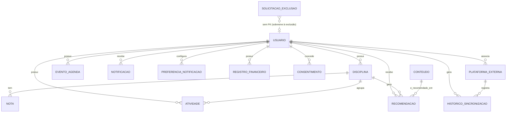

# Learning Score

Plataforma web que centraliza a vida acadêmica do estudante: atividades, prazos, notas, informações financeiras, calendário, notificações, recomendações de conteúdo e mini-player de vídeo.
Projeto acadêmico de Engenharia de Software (Igor e Lucas).

> **Estado de verificação (leia):** o código foi escrito e revisado, mas **ainda não foi compilado nem executado** — o ambiente em que foi gerado não tinha Maven, PostgreSQL nem acesso à internet. Verificados: sintaxe do JavaScript, pacotes/imports internos do Java. **Pendente:** `mvn test`, subir a aplicação e percorrer as telas. Veja "Primeira execução" abaixo.

## Objetivo
Reunir em um painel único os compromissos acadêmicos, reduzindo esquecimentos de prazos. **Não usa inteligência artificial**: as recomendações usam um critério objetivo de palavras-chave.

## Tecnologias
Java 21 · Spring Boot 3.3 (Web, Data JPA/Hibernate, Security, Validation) · Maven · PostgreSQL 16 · Flyway · HTML5/CSS3/JavaScript puro · Chart.js (CDN) · JUnit 5, Mockito, Spring Boot Test.

## Pré-requisitos
JDK 21, Maven 3.9+, PostgreSQL 14+ (ou Docker).

## Banco de dados (PostgreSQL)
```bash
export DB_PASSWORD='troque_esta_senha'
docker compose up -d            # sobe o PostgreSQL com banco/usuário "learningscore"
```
Sem Docker: crie o banco `learningscore` e o usuário `learningscore` com a senha escolhida. As tabelas são criadas pelo **Flyway** (`backend/src/main/resources/db/migration/V1__criar_esquema.sql`) ao iniciar.

## Executar o back-end (e o front-end)
```bash
cd backend
export DB_PASSWORD='troque_esta_senha'
mvn spring-boot:run
```
Abra **http://localhost:8080**. O front-end fica em `backend/src/main/resources/static/` e é servido pelo próprio Spring Boot (mesma origem → sem CORS e com cookie de sessão seguro). Escolhemos isso em vez de uma pasta `frontend/` separada para rodar com um único comando; para separar depois, basta servir a pasta `static` em outro servidor e ajustar `CORS_ALLOWED_ORIGINS`.

### Variáveis de ambiente
| Variável | Padrão | Uso |
|---|---|---|
| `DB_PASSWORD` | **obrigatória** | senha do PostgreSQL |
| `DB_URL` / `DB_USER` | `jdbc:postgresql://localhost:5432/learningscore` / `learningscore` | conexão |
| `DEMO_ENABLED` | `true` | cria dados de demonstração na 1ª execução (use `false` em produção) |
| `DEMO_PASSWORD` | `Demo@12345` | senha dos usuários demo |
| `COOKIE_SECURE` | `false` | `true` em produção (HTTPS/TLS) |
| `CORS_ALLOWED_ORIGINS` | `http://localhost:8080` | origens permitidas |
| `SPRING_MAIL_HOST`, `_PORT`, `_USERNAME`, `_PASSWORD` | — | SMTP para o e-mail de confirmação de exclusão (RF12). Sem isso, o e-mail **não** é enviado e a tela informa isso |

Nunca grave senhas no repositório (`.env` está no `.gitignore`).

## Dados de demonstração
Com `DEMO_ENABLED=true` são criados (todos **fictícios**, com prefixo `[DEMO]` e e-mails `@learningscore.local`):
- Estudante: `demo@learningscore.local` / `Demo@12345`
- Professor (pode aprovar conteúdos): `professor.demo@learningscore.local` / `Demo@12345`
- 3 disciplinas, notas, 6 atividades (uma atrasada, uma concluída), eventos, 3 mensalidades e conteúdos.
Os conteúdos de demonstração **não têm vídeo**. Para testar o mini-player, use *Conteúdos → Sugerir conteúdo* com um link real do YouTube, informe o e-mail do professor e aguarde a confirmação pelo convite.

## Testes
```bash
cd backend && mvn test
```
Cobertos: critério de compatibilidade (RF09), regras de status e isolamento por estudante (RF02/§9), conversão/validação de links de vídeo (RF11). **Lacuna conhecida:** não há testes de integração com banco (seria necessário Testcontainers/PostgreSQL) nem testes dos endpoints com Spring Security (`@SpringBootTest` + `MockMvc`); recomendamos adicioná-los na Etapa 7.

## Estrutura
```
learning-score/
├── backend/
│   ├── pom.xml
│   └── src/main/
│       ├── java/br/com/learningscore/
│       │   ├── common/          exceções, tratamento global de erros, entidade base
│       │   ├── config/          SecurityConfig, agendador de tarefas, dados de demonstração
│       │   ├── seguranca/       usuário autenticado, filtro CSRF
│       │   ├── usuario/         cadastro, login (RF10)
│       │   ├── atividade/       RF02, RF03
│       │   ├── dadosacademicos/ disciplinas, notas, financeiro (RF04)
│       │   ├── agenda/          calendário e eventos (RF05, RF06)
│       │   ├── notificacao/     RF07, RF08
│       │   ├── conteudo/        catálogo e aprovação (RF09, RF11)
│       │   ├── recomendacao/    critério de compatibilidade (RF09)
│       │   ├── integracao/      plataformas externas e sincronização (RF10)
│       │   ├── privacidade/     consentimentos e exclusão de conta (RF12)
│       │   └── dashboard/       RF01
│       └── resources/{application.yml, db/migration/, static/}
├── scripts/backup.sh            backup diário 03h (cron)
├── docker-compose.yml
└── README.md
```
Cada módulo segue: Entity → Repository → Service (regras) → Controller (REST) + DTOs (`*Dtos`). Toda consulta recebe o `id` do estudante logado (`UsuarioAutenticado.id()`), nunca um id vindo do cliente.

## Modelo de dados

Exclusão de conta: `ON DELETE CASCADE` nas tabelas do estudante; `solicitacao_exclusao` guarda só o hash do e-mail.

## Como os requisitos foram atendidos
| Item | Onde / como |
|---|---|
| RF01 | `GET /api/dashboard`: ≤5 prioritárias, 2 gráficos, indicadores. *Meta de 3 s não foi medida ainda.* |
| RF02 | CRUD `/api/atividades`, até 50 por página, filtros, status Pendente/Em andamento/Concluída/Atrasada (atualizado ao consultar e a cada 10 min) |
| RF03 | campo `linkEntrega` + botão que abre o link; não há envio de trabalhos |
| RF04 | `/api/disciplinas`, `/api/notas`, `/api/financeiro` — cadastro manual, avisos de que não são dados oficiais |
| RF05/06 | `/api/calendario?ano=&mes=` (prazos + eventos), visão mensal, CRUD `/api/eventos` |
| RF07/08 | notificações internas geradas por fatos reais; preferências no banco |
| RF09 | compatibilidade = palavras-chave da disciplina presentes no conteúdo ÷ total de palavras da disciplina (≥ 80%); só conteúdos aprovados por **professor convidado por e-mail**; até 3 por disciplina (se houver menos conteúdos elegíveis, a tela informa — não completamos com itens incompatíveis) |
| RF10 | cadastro/login/logout, sessão + CSRF, plataformas associadas por estudante, `ConectorPlataforma` como ponto de extensão OAuth 2.0. **Todas as integrações são simulação** (identificadas na tela e no histórico) |
| RF11 | mini-player (YouTube/Vimeo por lista de permissão), minimiza e persiste ao navegar |
| RF12 | consulta de dados, consentimentos, solicitação com senha, cancelamento, exclusão processada em ≤ 1 h (a cada 10 min; limite 24 h), e-mail só se SMTP configurado |
| RN01–04 | identidade única; auto-sync a cada 6 h; sync manual ≤ 1/min (HTTP 429); consentimento exigido |
| Senhas | BCrypt (custo 12) via Spring Security |

## Endpoints principais
Todos exigem sessão, exceto `register` e `login`. Requisições que alteram dados enviam o cabeçalho `X-XSRF-TOKEN` (valor do cookie `XSRF-TOKEN`). Erros: JSON `{status, erro, mensagem, campos}`.

| Método e rota | Descrição |
|---|---|
| `POST /api/auth/register` · `/login` · `/logout` · `GET /api/auth/me` | autenticação |
| `GET /api/dashboard` | painel |
| `GET/POST /api/atividades` · `GET/PUT/DELETE /api/atividades/{id}` | atividades (`?status=&disciplinaId=&pagina=&tamanho=`) |
| `GET /api/calendario?ano=&mes=` · `POST /api/eventos` · `GET/PUT/DELETE /api/eventos/{id}` | agenda |
| `GET/POST /api/disciplinas` · `PUT/DELETE /api/disciplinas/{id}` · `POST /api/disciplinas/{id}/notas` · `PUT/DELETE /api/notas/{id}` | acadêmico |
| `GET/POST /api/financeiro` · `PUT/DELETE /api/financeiro/{id}` | financeiro |
| `GET /api/notificacoes` · `PATCH /api/notificacoes/{id}/lida` · `POST /api/notificacoes/marcar-todas-lidas` · `DELETE /api/notificacoes/{id}` | notificações |
| `GET/PUT /api/preferencias-notificacao` | preferências |
| `GET /api/recomendacoes` | recomendações por disciplina |
| `GET/POST /api/conteudos` · `GET /api/conteudos/minhas-sugestoes` · `POST /api/conteudos/{id}/reenviar-convite` | conteúdos |
| `GET/POST /api/integracoes` · `DELETE /api/integracoes/{id}` · `POST /api/integracoes/{id}/sincronizar` · `GET /api/integracoes/historico` | integrações (simuladas) |
| `GET /api/privacidade/meus-dados` · `GET/PUT /api/privacidade/consentimentos` · `POST/DELETE /api/privacidade/exclusao` | privacidade |

## Segurança e requisitos não funcionais
- Sessão com cookie `HttpOnly` + `SameSite=Lax`, CSRF por cookie/cabeçalho, `changeSessionId` no login, mensagem de login genérica, CORS restrito.
- Isolamento: recursos de outro estudante respondem 404.
- Front-end escapa todo texto dinâmico (`esc()`); links de entrega só `http(s)`; vídeos só YouTube/Vimeo.
- **HTTPS/TLS**: não é configurado no projeto — em produção use proxy reverso (Nginx/Caddy) com certificado e `COOKIE_SECURE=true`.
- **Backup às 03h**: `scripts/backup.sh` + cron. **Disponibilidade de 99%** é meta de operação, não algo que o código garante.
- **Acessibilidade WCAG 2.1 AA**: foco visível, rótulos, `aria-*`, link "pular para o conteúdo", respeito a `prefers-reduced-motion`, contraste calculado nas cores principais. **Não foi feita auditoria** (use axe/Lighthouse e teste com leitor de tela).
- Não implementado: limite de tentativas de login (força bruta) e recuperação de senha.

## Primeira execução (checklist sugerido)
1. `mvn test` → corrigir eventuais erros de compilação.
2. Subir o banco e `mvn spring-boot:run` → conferir no log a execução da migração V1 e a mensagem dos dados de demonstração.
3. Entrar com o usuário demo e percorrer as 13 telas; criar uma segunda conta e confirmar que não enxerga dados do demo.

## Ajustes de interface e cadastro (17/11/2026)

- Notificações: acesso pelo sino no Dashboard, com contador de não lidas; a rota continua disponível e saiu do menu lateral.
- Mobile: logo no cabeçalho com link para o Dashboard.
- Cadastro: consentimentos de integrações e uso de dados externos são opcionais, independentes e desmarcados por padrão. As escolhas são gravadas na mesma transação da criação da conta e podem ser alteradas em Privacidade e conta.
- Notas: média simples das avaliações convertidas para a escala de 0 a 10, incluindo notas antigas. O peso saiu do formulário, da tabela e dos DTOs da API. A coluna legada permanece no banco para compatibilidade; não influencia os cálculos. A escala continua de 0 a 10.
- Não é necessária migração de banco para estes ajustes.

## Valor da prova e logo mobile

O cabeçalho mobile usa logo-completo-escuro.png. Ao lançar ou editar notas, informe a nota obtida e o valor da prova (de 0,01 até 10, campo inicialmente em branco e obrigatório). A nota obtida não pode ultrapassar o valor da prova. O valor da prova fica salvo e visível na tabela; a média converte cada nota para a escala de 0 a 10 antes de calcular a média simples.

A migração Flyway V2 adiciona o valor da avaliação ao banco e atribui 10 às avaliações existentes. Ela é aplicada automaticamente na próxima inicialização do backend.

## Avaliação de conteúdo por e-mail

Em Conteúdos → Sugerir conteúdo, os quatro campos existentes foram mantidos e foi acrescentado somente E-mail do professor. O estudante é identificado pela sessão; o endereço para receber o resultado vem da conta autenticada.

A sugestão começa PENDENTE. O professor recebe os detalhes e os botões Aprovar e Recusar, sem precisar de conta. Os botões abrem /avaliar-conteudo.html e apenas consultam o convite. A resposta exige confirmação por POST com CSRF e o campo único Justificativa e links sugeridos (obrigatório, até 4.000 caracteres). Somente essa confirmação aprova ou recusa. O catálogo e as recomendações continuam mostrando apenas aprovados.

O estudante consulta suas próprias sugestões em Conteúdos → Minhas sugestões, com decisão, data, justificativa e links http(s) clicáveis. O catálogo compartilhado não expõe a justificativa ou os e-mails. O antigo endpoint de aprovação por perfil de professor foi removido. Perfis e dados anteriores foram preservados.

### Configurar o envio

Defina SPRING_MAIL_HOST, SPRING_MAIL_PORT, SPRING_MAIL_USERNAME, SPRING_MAIL_PASSWORD e MAIL_FROM no ambiente. Use PUBLIC_BASE_URL com a URL HTTPS pública da instalação: localhost só serve para testar na própria máquina. O link precisa ser acessível ao professor. SMTP_AUTH e SMTP_STARTTLS_ENABLE começam true; ajuste conforme o provedor. Para SMTP com SSL implícito (porta 465), configure também spring.mail.properties.mail.smtp.ssl.enable e desative STARTTLS conforme o provedor. As conexões SMTP têm limite de cinco segundos para conexão, leitura e escrita. Nunca grave credenciais no código nem versione .env.

AVALIACAO_VALIDADE_HORAS define a validade do convite (72 horas por padrão; entre 1 e 168). O token contém 32 bytes aleatórios, só seu SHA-256 vai para o banco e a confirmação remove o hash. Os dois botões compartilham o mesmo convite: apenas uma resposta vence, inclusive em acessos simultâneos. O token fica no fragmento do link, não é enviado na URL HTTP e é retirado do histórico ao abrir a página. Não encaminhe o convite: quem o possui pode responder.

### Falha de e-mail e migração

A migração Flyway V3 é aplicada ao iniciar. Conteúdos antigos aprovados continuam aprovados. Pendentes antigos sem e-mail do professor devem ser sugeridos novamente; não foram inventadas respostas para eles.

O envio só é tentado depois de salvar a transação. Sem SMTP ou com falha de envio, a sugestão continua salva e a tela informa que o convite não foi enviado. O estudante pode reenviar (intervalo mínimo de um minuto); isso gera uma chave nova, renova a validade e invalida a anterior. A resposta confirmada permanece salva mesmo se o e-mail do resultado falhar; o resultado é consultável imediatamente no aplicativo e o envio é tentado novamente a cada dez minutos, em lotes de até 50. O envio usa o EmailService já existente. Como em SMTP em geral, uma interrupção logo após a aceitação pode causar duplicidade de e-mail numa nova tentativa; não permite duplicar a decisão.

### Verificação

Execute mvn test em backend para os testes unitários. Para os testes HTTP completos, prepare um banco PostgreSQL separado e defina LS_TEST_DB_URL, LS_TEST_DB_USER e LS_TEST_DB_PASSWORD (nunca use o banco de produção). Os testes de integração são ignorados quando LS_TEST_DB_URL não está definido. Eles verificam migrações, isolamento, CSRF, expiração, reenvio, recusa, aprovação, falha de SMTP e duas confirmações simultâneas. Os e-mails são simulados nesses testes; a entrega real deve ser validada com o SMTP da instalação.

## Ajustes após a revisão de telas

- Tema escuro: links, etiquetas, indicadores e categorias do calendário com cores claras sobre os fundos escuros.
- Mobile: gaveta abaixo do cabeçalho, botão Fechar menu acessível, fechamento pela própria página, Esc ou fundo. Menu fechado e conteúdo coberto ficam fora da navegação pelo teclado conforme o estado. Sem rolagem horizontal no Dashboard a 320 pixels.
- Média: cada nota é convertida por nota obtida ÷ valor da prova × 10; a média simples usa esses valores e só arredonda o resultado final para duas casas. Exemplo: 4 de 5 e 10 de 10 resultam em média 9. Nenhuma nota salva foi alterada; os resultados são recalculados ao consultar.
- Mini-player: opção Abrir vídeo na plataforma, inclusive como alternativa se o provedor bloquear a incorporação.
- Testes: 38 testes Java aprovados, inclusive integração com banco separado. Envio de convite e de resultado validado por SMTP local de captura; isso não comprova entrega no Gmail.

Para Gmail, use smtp.gmail.com, porta 587, SMTP_AUTH=true e SMTP_STARTTLS_ENABLE=true. Configure o endereço completo em SPRING_MAIL_USERNAME e MAIL_FROM; a credencial autorizada fica em SPRING_MAIL_PASSWORD, apenas no ambiente local do processo. O fluxo SMTP atual não implementa OAuth do Google: quando disponível na conta, uma senha de app pode ser usada com verificação em duas etapas. Referências: https://support.google.com/mail/answer/7104828 e https://support.google.com/accounts/answer/185833?hl=pt-BR. O Spring Boot não carrega .env automaticamente neste projeto; exporte as variáveis ou use as variáveis de ambiente da configuração de execução no IntelliJ.
